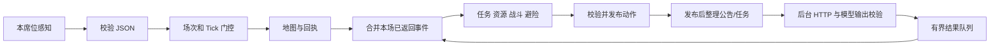

> 历史记录：本文执行次数与停止状态描述当时事实。当前按真实代码迭代、每固定场景最多3次，见verification-policy.md；不沿用旧的全阶段累计上限。

# 主流程接入与第二阶段基础实现

日期：2026-10-21。继续执行用户“先把代码尽可能完善”的要求，本轮只构建自研程序并进行离线/隔离接口验证，没有启动裁判比赛、调用真实模型或修改官方文件。

## 这一步的功能

之前主节点只会采集，AI、事件和战斗模块独立存在。本版新增 ROS 无关的 BotRuntime，将这些模块接入同一个控制流程。显式第二阶段不再被启动检查拒绝，但这是一版基础实现，不能当作完整参赛验收。

“异步”表示主线程不会等网络完成。已返回结果会在本 Tick 决策前合并；新请求在发布动作后排队。模型输出的 JSON 清洗、Schema 和语义验证也移到了 HTTP worker。合并预算1ms是逐项检查的软预算，单条合并不能被强行中断；不能因此声称已有严格1ms上界。

## 输入和配置

补齐 self.defending、respawn_in、score.mission_completed/invalid_actions 的可选类型字段。它们缺失或类型不合格时保持未知，不补造真值；defending只是上一状态，不能直接推断敌人下一步仍防御。

配置优先级：环境变量覆盖 connection JSON，再使用固定默认值；身份支持三个启动参数或三个环境变量。正式令牌使用 RMTC_TEAM_TOKEN，同时保留 RMTC_AI_TOKEN 兼容；二者冲突时拒绝启动且不打印值。AI 完整 URL 按公告注入，不用 referee_ip 猜端口。没有L/非正L禁用AI但继续控制，类型错误等配置错误明确拒绝启动。

decision_config.json 只放一个 decision_type，接受 balanced/collect，拒绝坐标、目标或其他键；只在启动读取。赛中批准切换、次数登记及重启是否计额度仍未完成，不能据此声称 B6 全部通过。

## 公告与调用预算

公告处理只检查消息换行边界和完整正文是否重复，不读取关键词、时间、坐标或事件名称。同场缓存最多512条/2MiB，待提交64条；超限丢弃并记录计数，不通过无限缓存拖垮控制。每条新公告一个来源ID和请求，不周期复盘。

后台最多1个HTTP在途、待办8、结果64。控制线程每Tick最多取16项，在1ms软预算内合并；未关联通知最多32条并保留原观察Tick，旧代次结果不进入新场。

同一个 scheduler 对应不变令牌：2xx消耗预算，即使模型正文坏；未知结果保守预留预算且冷却35秒。换 session 不清令牌预算，避免自动重开后假装额度恢复。暂按规则100次，公告为0才不限。未知额度是否实际扣除不自动退款，这会降低可用次数，需要在真实代理验证中记录代价。

第二阶段有事件时先解释事件；无事件时排一次任务解释。首次本地2xx观察只用于停止重复资格任务，不替代裁判真实成功资格，mock不算正式资格。缺少真实接入时仍可能任务分为0，该风险并未因写好代码消失。

## 决策与安全

第一阶段继续用采集核心；默认规划100 Tick，auto确认战斗后500。软时长到达不停止动作。复用了距离、首方向、占位、候选和堆缓冲；Tick中位数改用固定5元素数组。本轮没有用这项改动宣称p99目标已达成。

第二阶段新增公开 reach 坐标导航、普通/高价值采集任务及资源/伤害备用任务的基础收益评价。资源计数只从连续帧积分增量和已知落点资源相互印证得到下界，完成与否仍由官方ID确认。

攻击与移动都承担当前位置的本 Tick 攻击风险，防御另算减伤；阵亡移动的后续收益为0，同时攻击仍可计有效伤害。保守攻击假设敌人防御，反伤窗口下会拒绝无伤害且可能被反弹的攻击。collect 的攻击门槛比 balanced 高。

爆炸/分裂使用最长32 Tick的避险搜索，先检查 T+1 位置的预移动危险，因此爆炸T的最后逃离动作是T-1。辣椒按可能的敌方入点和我方移动后位置检查十字叠加伤害；defend不减免环境伤害。幻术 MOVE 按已解释窗口或合法回执补偿，其他方向不反转。

这是保守局部模型：敌人可能不攻击，也可能具有未确认的增益；未来位置并非预测真值。当前没有主动争夺回血/堡垒、高阶追击或集火；P6/P7及全部复杂事件组合仍未验收，不能标记“完整P0–P9完成”。

## 本轮发现并修复的问题

首轮12项里2项失败：把非致命掉血按四个失控Tick的代价计，且给本Tick已阵亡动作再次扣下一位置风险，导致防御和同归于尽攻击被错误压低。修正后非致命掉血按共同机会收益率计，死亡成本保持共同基准；已阵亡没有下一位置风险。

另加了异常保护：策略钩子异常时发当前Tick的WAIT。接受新Tick就清旧动作缓存，因此重复新帧不会误发上一个Tick的动作。测试专门注入异常并检查缓存Tick。

## 验证结果与次数

| 场景 | 执行情况 | 结果 |
| --- | --- | --- |
| 首批12个新用例 | 第1次10通过2失败，第2次全通过，第3次全通过 | 到三次，不再重跑 |
| 新增恢复/辣椒3个用例 | 各1次 | 通过 |
| 错误诊断/密钥回显过滤 | 3次 | 通过，到三次 |
| 非正L继续控制 | 2次 | 通过 |
| 官方令牌变量/冲突检测 | 1次 | 通过 |
| 新隔离ROS＋本地假HTTP综合场景 | 2次 | 通过 |

总计本次新增18个不同TEST，不把重跑累计成测试数量；此前65项保留历史证据，没有把旧核心/LLM组跑到第4次。本轮构建通过GCC11.4、CMake3.22.1、ROS2 Humble，最终构建日志未报告自有代码警告。没有做新的ASan/UBSan或性能结论。

隔离域39综合检查实际运行自研节点：三次move/up，一次defend；T1日志原因为P1_event_deadline_escape；只向本地假服务发1次请求；从配置文件读URL/model/L、从RMTC_TEAM_TOKEN读固定假令牌；日志含席位/阶段/回执/预算/HTTP状态，不含假令牌；Ctrl+C退出0。

该工具合成感知，不能证明车辆真的移动或正式invalid_actions=0；last_action与score由测试工具输入，不冒充裁判执行证据。真实模型调用0，自研裁判比赛0，正式任务资格未确认。

## 后续仍需完成

先完善剩余事件组合与追击/事件收益、正式decision_type登记/批准切换流程、故障诊断和回放材料。代码稳定后再按用户安排接官方裁判取得真实last_action、默认节奏采集、20×20/24×24覆盖与重启恢复证据；然后接用户DeepSeek真实服务经测试代理测时延/输出。正式模型/L/网关、重启计数仍需官方确认。

镜像、异机DDS、检录录屏和最终技术报告也未完成。当前完成的是基础主流程接入与隔离验证，不是整个赛前任务。

证据：rmtc-bot/evidence/runtime-integration-2026-10-21.json（15项及构建）、runtime-final-verification.json（诊断、最终ROS/HTTP、源码哈希及官方完整性）。官方16文件及原包哈希全部匹配，最后无referee_node运行。
