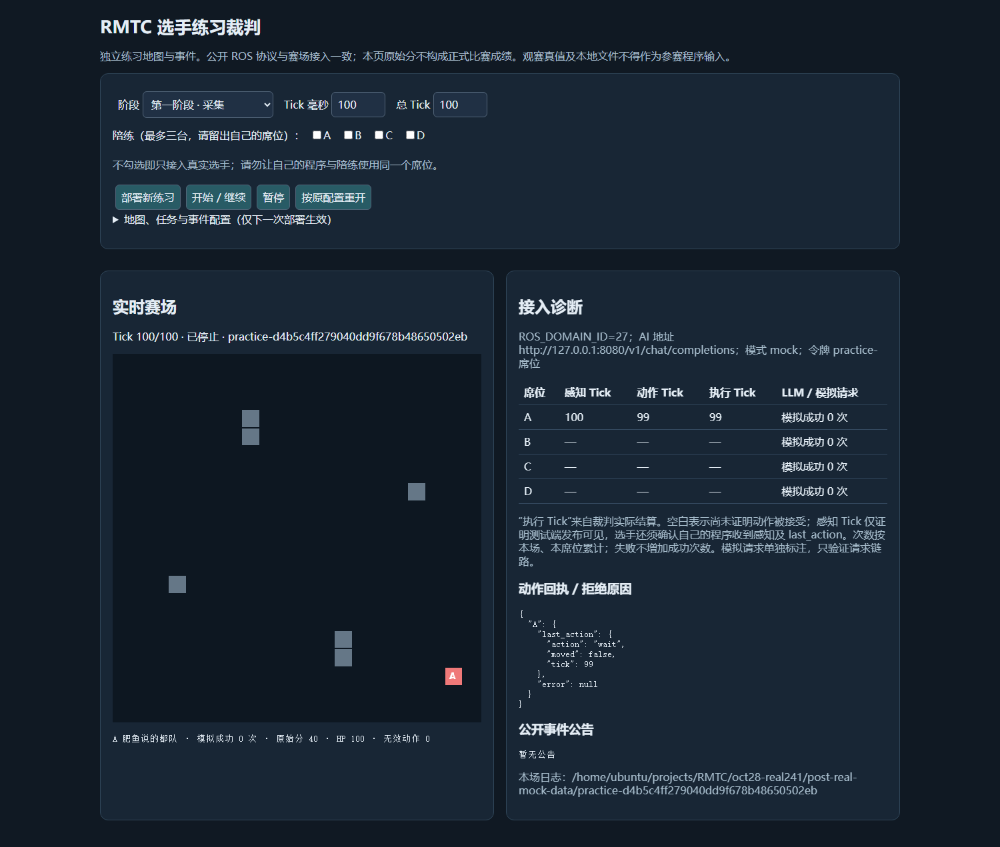
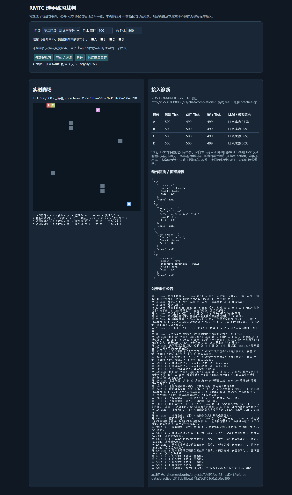
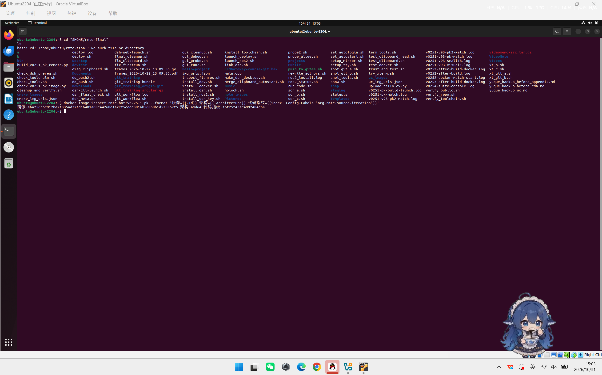
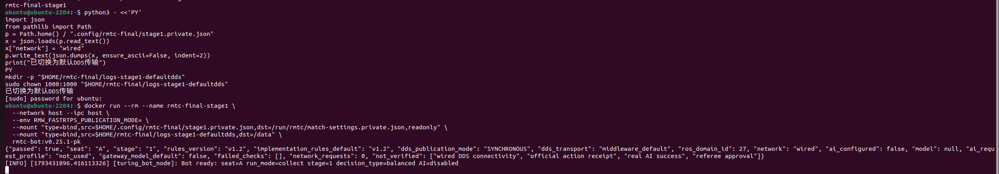
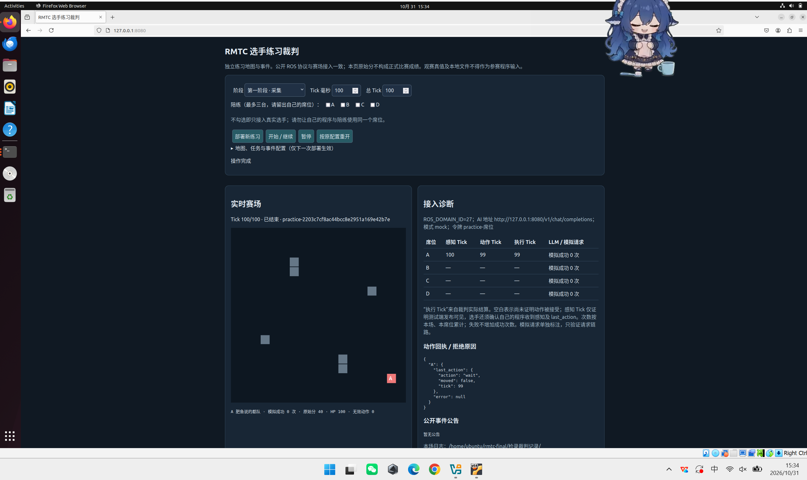
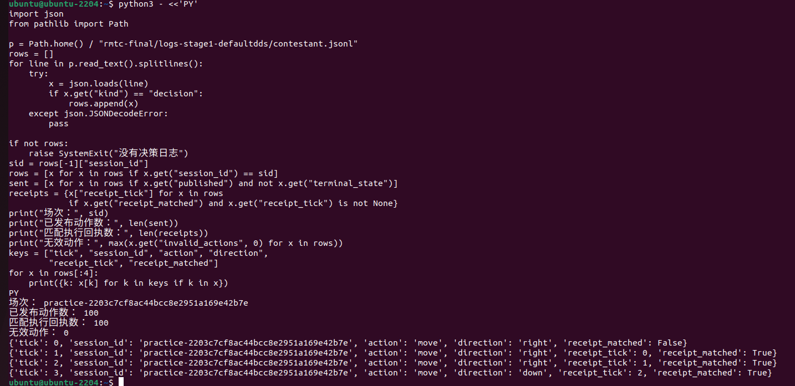
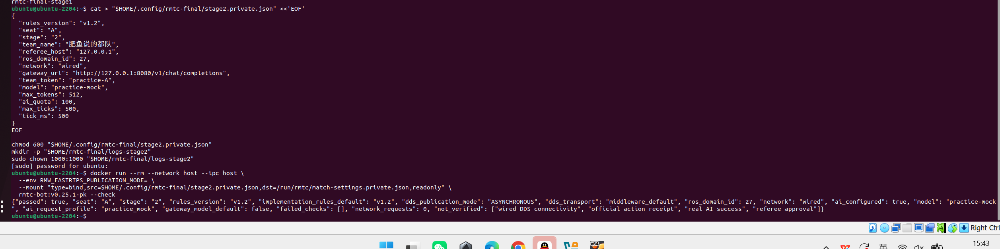
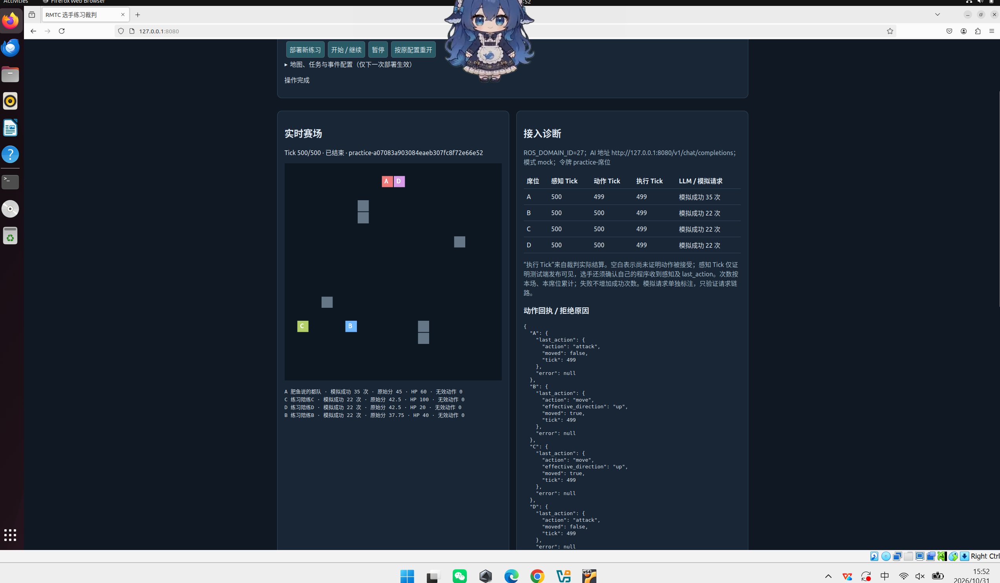
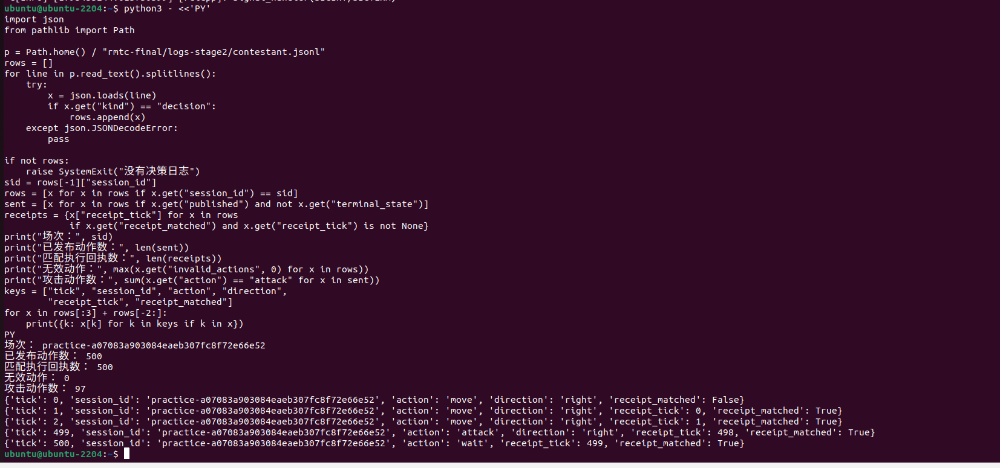
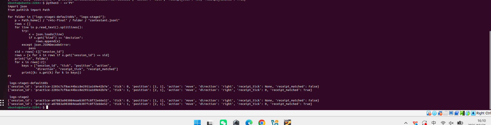

# 肥鱼说的都队｜RMTC 机甲大师图灵对决赛技术报告

材料状态：代码于2026年10月31日确定封版为 v0.25.1-final，底层实现为已验证的 v0.25.1-tail-offer-fix，不再修改参赛代码。编写依据为《RMTC机甲大师图灵对决赛参赛手册》。现场接入、前置检录和赛事正式提交仍按实际结果登记。

| 项目 | 内容 |
|---|---|
| 正式队名 / 队伍编号 | 肥鱼说的都队 / 12 |
| 队长 | 蔡礼格 |
| 队员 | 蔡礼格、李宸梓 |
| 代码仓库 / 语雀链接 | [代码仓库](https://github.com/clg506921-boop/competiton) / [语雀文档](https://www.yuque.com/ahz56/cbis6h/nlgzqv1hvhksyz2c) |
| 报告代码基线 | v0.25.1-tail-offer-fix |
| 最终封版版本与启动路径 | v0.25.1-final；Docker容器内工程 `/opt/rmtc`；程序 `/opt/rmtc/contestant_ws/install/rmtc_bot/lib/rmtc_bot/turing_bot_node` |

## 1. 设计目标与总体架构

本队围绕两个赛段建立同一套参赛程序。第一阶段以可靠定位、探索、避障和资源采集为核心；第二阶段在此基础上加入任务完成、攻防判断、事件理解和异常恢复。程序优先保证每个有效 Tick 都能及时给出合法动作，再在公开信息范围内比较收益与风险。

控制端采用 C++17 和 ROS 2 Humble，使用 std_msgs/msg/String 承载协议 JSON。感知与动作使用 RELIABLE、VOLATILE、KEEP_LAST(1)。主流程为：

本席位感知 → 解析与状态校验 → 更新局部地图和任务记忆 → 本地决策 → 动作合法性检查 → 发布当前动作 → 在后续感知中核对 self.last_action。

自然语言公告走独立的异步 HTTP 通道：公开公告 → LLM 解释 → 输出校验 → 事件记忆 → 本地决策。模型不直接发布控制动作，模型请求不会同步阻塞逐 Tick 控制。

## 2. 功能实现

| 模块 | 已完成的实现 |
|---|---|
| 协议与定位 | 读取当前 session_id、tick、self.position；区分本车绝对坐标和实体相对位置图；格式异常不作为有效状态继续规划 |
| 地图与导航 | 记忆已知障碍、资源和访问情况，计算可达路径；没有合适资源时探索未知区域 |
| 第一阶段采集 | 使用 A 席位，自主执行 move/wait；走到资源格自动采集，不额外发送拾取指令 |
| 第二阶段任务与对抗 | 从结构化 missions 读取任务；比较资源、任务、攻击、防御、移动和等待候选；使用裁判提供的有效伤害与完成信息 |
| 场次与恢复 | 新场次重置规划及异步关联；重复 Tick 复用动作而不重复推进状态；阵亡时等待，复活后采用新感知位置 |
| AI 与事件 | 独立工作线程请求统一风格网关；校验事件来源、时间、主体、区域和场次关联；错误、超时或不合法输出不直接改变动作 |
| 日志与核验 | 记录版本、场次、Tick、动作、回执、处理耗时及错误；通过本车后续感知确认执行，不以“已发送”代替执行成功 |

本车位置始终以当前 self.position 为准，不根据“发出移动命令”累计位移。公开感知之外的地图全图、裁判配置和观赛数据仅用于人工测试分析，不进入参赛程序的决策输入。

## 3. 两阶段运行逻辑

第一阶段显式选择 stage="1"、seat="A"，关闭 AI，以资源采集和探索为目标。使用 100 ms/Tick、100 Tick 单独验证并保留成绩；按手册，第一阶段最高40分、用于种子排位，不在本文自行与第二阶段原始分数相加。

第二阶段选择 stage="2"，席位按本场分配。程序以当前公开任务、资源和敌车状态决策；同时考虑受伤、阵亡、复活保护和已经确认的事件效果。有效伤害直接读取裁判值，不自行再次累加击杀奖励或扣死亡惩罚。任务坐标来自 missions，不按练习地图写死路线。

基线还使用连续公开运动观测做有限的短时追击判断，避免把同速跟跑误当成持续接近目标。没有把其他车辆视作合作队友，也不假定对手会按某条固定路线行动。

最终版本不启用比赛中人工策略切换。启动时读取 decision_type="balanced"；采集、探索、攻击和避险由程序根据公开感知自动决策，不自动改写策略配置文件。

## 4. 真实 AI 接入与协同开发

按参赛手册，正式第二阶段使用 POST /v1/chat/completions、本场席位 Bearer 令牌、model="deepseek-flash"、max_tokens=512。程序按此前主办方通知设置顶层 thinking={"type":"disabled"}，并请求 JSON 输出。网关地址、席位和令牌由本场配置提供，不在源码中固化。

公告文本由 LLM 理解后，再进入程序的结构化校验链路；不使用关键词、正则或固定事件时间表替代 LLM。结构化 missions 则直接按协议解析。HTTP返回成功、事件通过校验、事件被本地采用以及正式计分资格，分别核验。

本队已完成一次 v0.25.1 真实练习网关专项：140 Tick、16次实际上游请求全部成功、并发上限1、输出上限512，8条事件通过校验并合并，本车140/140回执匹配。该记录属于练习专项，不替代正式比赛本场、本席位至少一次真实统一AI成功调用的资格要求。正式令牌不写入仓库、截图或报告。

开发协作中，蔡礼格和李宸梓提供规则、决策意图及实际运行现象；Codex辅助规则梳理、代码实现、回归验证、日志分析和文稿整理。其他AI的建议先作为假设，与源码、规则及原始日志核对后再决定是否采用。队员对最终代码和报告负责，并在答辩前分别复核自己负责的实现。

## 5. 队内分工

| 队员 | 实际主要工作 |
|---|---|
| 蔡礼格 | 制定决策方案、初步代码编写、网关搭建 |
| 李宸梓 | 后期调试、代码迭代修改及优化 |

以上分工由队员确认；队长为蔡礼格。

## 6. 已完成测试与证据

以下为已完成的 v0.25.1 练习记录。实际裁判为官方 v1.1 练习端，不能写成已通过正式终版裁判验收。

| 场景 | 成绩 | 本车执行回执 |
|---|---|---|
| 第一阶段，20×20，A，100 Tick | 40分，资源200，0无效动作 | 100/100匹配 |
| 第二阶段，24×24，A，500 Tick，B为队友程序、C/D为陪练 | 第2名，42.5分，资源50，有效伤害530，任务3 | 500/500匹配 |
| 第二阶段，18×18，A，500 Tick，同组对手配置 | 第1名，45分，资源60，有效伤害1435，任务3 | 500/500匹配 |
| 真实练习网关专项，140 Tick | 16次真实请求成功、8条事件采用 | 140/140匹配 |

表中第二阶段完整比赛使用mock网关，不能用其请求结果证明正式AI资格。单图、单席位成绩也不代表所有地图和对手的总体水平。未通过的测试保留在研发记录中，不以最高分替代稳定性验收。

### 6.1 本队实际感知—动作—回执示例

取自本队 v0.25.1 的同一通过场次，场次为 practice-8a36256b33d049eeb8e2cefe1449080d：Tick1感知中位置为[2,1]；程序发布以下动作，原样回填场次和Tick。

```json
{"action":"move","direction":"right","session_id":"practice-8a36256b33d049eeb8e2cefe1449080d","tick":1}
```

Tick2感知中 self.position 为[3,1]，self.last_action 为：

```json
{"action":"move","effective_direction":"right","moved":true,"tick":1}
```

完整原始片段及本车回执汇总见附件“证据”。这是实际日志片段，不是手工遥控或重建的模拟数据。

### 6.2 本队历史测试截图

以下两图为本队 v0.24.1 的真实研发测试截图，仅展示已完成的历史联调，不冒充 v0.25.1 或最终封版检录截图。



图1：本队历史版本第一阶段练习页面，显示Tick100、采集40分及执行回执。



图2：本队历史版本第二阶段真实练习记录。图中24次成功调用属于该历史场次，与上表v0.25.1的16次/140Tick专项不是同一场，不混用次数或资格。

最终封版镜像启动、两阶段动作回填与执行回执截图已补，见6.3节。感知数字坐标position展示已补入6.3.4节；本次为练习端验证，不替代主办方现场检录。

### 6.3 最终镜像两阶段检录记录（2026年10月31日）

队员使用最终镜像rmtc-bot:v0.25.1-pk完成官方练习端两阶段运行，代码及镜像均未修改。本节为最终版本的现场操作截图，不与6.2节v0.24.1历史截图混用。统计依据为队员在Ubuntu终端执行的本车日志查询截图，并由裁判网页结算佐证；新场次完整原始日志仍保留在参赛Ubuntu，本工作区未冒称已独立复算原始文件。

| 赛段 | 场景 | 发布动作 / 唯一匹配回执 | 结果 |
|---|---|---|---|
| 第一阶段 | A席，100ms×100Tick，无陪练 | 100 / 100 | 40分、0无效动作 |
| 第二阶段 | A席，500ms×500Tick，B/C/D官方陪练，mock | 500 / 500 | 45分、第1名、0无效动作、97次攻击 |

第一阶段场次：practice-2203c7cf8ac44bcc8e2951a169e42b7e。第二阶段场次：practice-a07083a903084eaeb307fc8f72e66e52。第二阶段网页显示35次mock模拟成功，不构成真实统一AI调用资格。末帧感知Tick100/500确认此前动作Tick99/499，不能仅因最后动作编号比总Tick少1就判漏帧。

首次仅回环UDP配置没有收到感知，失败记录单独保留，未列作通过。切换既有network="wired"（默认DDS）运行配置后发现我方订阅并完成闭环；这次仍为同机练习，不能宣称异机有线实战通过。启动时Bot ready的初始stage=1来自尚未接收感知的初始状态；第二阶段后续实际执行攻击，不能用启动显示替代运行中的赛段核验。

#### 6.3.1 最终镜像身份与启动



最终镜像身份、amd64架构与代码指纹。



默认DDS配置下最终容器启动并显示Bot ready。

#### 6.3.2 第一阶段采集与执行回执



第一阶段本队40分、0无效动作，动作和执行Tick到99。



第一阶段本车日志：100动作、100回执；Tick0动作在Tick1获得对应回执。

#### 6.3.3 第二阶段配置、结算与执行回执



第二阶段本队A席配置预检通过，mock模型、异步发送、默认DDS。



第二阶段500Tick结算：本队45分、第一名、0无效动作，最后攻击执行Tick499。



第二阶段本车日志：500动作、500回执、97次攻击；同场次Tick与回执逐帧对应。

#### 6.3.4 两阶段感知坐标、动作和回执对应



两阶段均在各自场次Tick0感知到position=[1,1]，发布move/right；Tick1感知到position=[2,1]，receipt_tick=0且receipt_matched=True。该截图直接展示本车使用的感知绝对坐标、session_id、tick、动作方向及对应回执，补齐感知—动作—执行证据。

最终镜像两阶段练习端检录材料已补齐。正式统一AI资格、工作人员现场审核、协作权限和正式提交回执仍据实登记。

## 7. 遇到的问题与已采取的方法

第一，车辆没有移动不一定是定位错误。移动可能被障碍、占位或状态约束拒绝，因此使用当前绝对位置和执行回执恢复，而不是按命令累加坐标。

第二，模型输出不等于可执行事实。我们将LLM放到异步通道，并校验来源、时间、场次和区域，保证模型失败时本地控制仍继续。

第三，单场高分不等于稳定。测试同时检查动作、回执、解析错误与无效动作，保留失败记录；确定性重复不当作独立统计样本。

本次封版停止引入优化候选。已知环境停顿和偶发时序风险仍按历史记录保留；正式网关资格、有线现场验收需以实际检录结果为准，不把练习通过等同正式资格。

## 8. 构建、启动与接入配置

运行环境为Ubuntu22.04、ROS2 Humble、Linux/amd64、C++17、CMake/colcon、libcurl和Python3。完整目录与依赖见仓库README。

在工程根目录执行源码构建：

```bash
source /opt/ros/humble/setup.bash
CMAKE_BUILD_PARALLEL_LEVEL=1 MAKEFLAGS=-j1 colcon build \
  --base-paths contestant_ws/src --build-base contestant_ws/build \
  --install-base contestant_ws/install --packages-select rmtc_bot \
  --cmake-args -DCMAKE_BUILD_TYPE=Release -DBUILD_TESTING=OFF
```

第一阶段使用私有阶段一配置，第二阶段改用本场的私有阶段二配置；两者使用同一程序入口，不更换为其他工作空间的同名节点。

```bash
bash prepare_match.sh --check /绝对路径/stage1.private.json
bash prepare_match.sh --launch /绝对路径/stage1.private.json
# 第一阶段结束并停止程序后，再按本场参数启动第二阶段：
bash prepare_match.sh --check /绝对路径/stage2.private.json
bash prepare_match.sh --launch /绝对路径/stage2.private.json
```

--check仅检查本地配置，不代替真实通信或AI资格。正式有线比赛使用network="wired"，同机是否使用"local"需与裁判DDS配置一致；本次默认裁判使用"wired"完成同机验证。本场IP、ROS域、席位、网关与令牌集中填入配置；session_id和tick由感知获取，不提前编造。具体填写项见《赛前参数填写卡》。


### 8.1 最终 Docker 启动方式

镜像标签保留已验收名称 `rmtc-bot:v0.25.1-pk`，最终包名不改变镜像内代码。镜像归档SHA256：`cfb62646f496a42ed04eff69c7929622c79928397a6bbca1fec4ada2d194d29c`。本地目录解压在任意位置，容器内启动路径固定为 `/opt/rmtc`。

```bash
gzip -dc rmtc-bot-v0.25.1-final.tar.gz | docker load
# 将参数模板复制到包外私有目录，填写本场网关/域/席位/令牌。
mkdir -p "$PWD/logs"
sudo chown 1000:1000 "$PWD/logs"
bash start-final.sh --check /绝对路径/stage1.private.json
bash start-final.sh --launch /绝对路径/stage1.private.json "$PWD/logs"
# 停止第一阶段程序，再用stage2.private.json按相同方式检查和启动第二阶段。
```

外部启动脚本仅清除镜像继承的发送模式，让已有程序按赛段选择第一阶段同步、第二阶段异步；不改源码或算法。`--check`不会调用模型，不代表正式AI资格。赛前仍需填写本场配置，现场令牌不进入仓库或公开文档。

## 9. 日程与提交安排

| 阶段 | 工作与产出 |
|---|---|
| 已完成：基础开发 | 协议解析、本地控制、采集、攻防与异步AI框架；保留源码和验证记录 |
| 已完成：联调验证 | 两阶段练习、真实练习网关专项、同机对抗及回执分析 |
| 10月30日：材料整理 | 按参赛手册撰写本报告、仓库说明、参数卡与材料清单 |
| 10月31日：代码封版 | 确定队名、队长、编号；冻结v0.25.1-final；整理源码和Docker镜像包；同步报告 |
| 10月31日20:00前 | 补最终检录截图，核对工作人员访问权限并完成正式提交 |
| 11月1日 | 按正式通知到场，领取本场接入信息、检录并参加两阶段比赛 |

封版源码、镜像内运行脚本和二进制已核对一致，代码指纹为 `1bf25f43ac4992484c5e`；Docker镜像为 `rmtc-bot:v0.25.1-pk`，Linux/amd64，容器内工程路径 `/opt/rmtc`。镜像沿用已经验收的精确归档，不重编译。源码锚点提交为 `a8571dcccc9a931d94db555a85572203cb5ffb22`，后续文档封版提交不改变生产代码。正式接入、工作人员访问授权及赛事提交回执继续据实补充。

